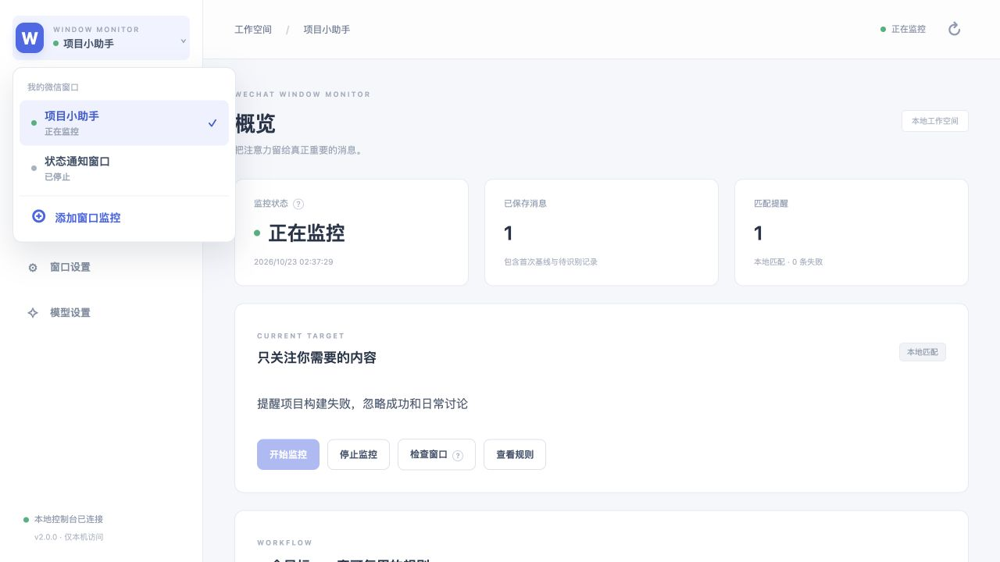

# WeChat Window Monitor

按**精确名称**监控微信会话窗口，用你自己的目标识别重要消息。支持群聊、私聊及符合原生消息列表结构的其他会话；不再附带讲座、校区、报名等专属策略。

**当前版本：2.0.0 · Python 3.11+ · 本地 Dashboard · 双识别核心。**

本机验收预发布；跨平台 Actions 当前受账户计费限制，详见 [验收报告](docs/generic/VALIDATION.md)。



## 从目标到提醒

1. 左上角窗口下拉菜单底部点 **⊕ 添加窗口监控**，填写完整窗口名称、识别目标和模式。
2. 在窗口设置完善采集来源。本地匹配可直接使用网页版 AI，无需配置 API；使用 API 生成或语义识别时，在模型设置填写兼容 Chat Completions 接口、模型与密钥。
3. 在“识别规则”页导出提示词交给网页 AI 后导入，或点击“调用模型生成规则”。结果先保存为规则草稿；可编辑、试测，保存不可变的版本，再明确启用。
4. 手动开始监控。窗口名旁绿点表示正在运行且成功采样，灰点表示停止/启停中；窗口不可读、识别异常用文字与异常色说明。
5. 在消息记录查看匹配提醒、原文、依据、所用规则与失败状态。识别失败保留原文，可重试。

| 核心 | 生成阶段 | 每条新消息 | 适用目标 |
| --- | --- | --- | --- |
| 本地匹配 `local` | 网页 AI 导入或 API 生成有限字符串规则 | 本机匹配，不调用模型 | 明确关键词、发送者、消息类型或附件名 |
| 语义识别 `llm` | LLM生成可复用语义指令 | 以已保存规则调用LLM | 复杂意图、上下文语义、难以穷举的表达 |

生成并非每轮采样重新发生。改变目标或模式会解除旧活动规则，需重新生成/编辑并启用。规则草稿不会自动生效；测试不入消息库。本地 DSL 不执行模型生成的 Python、JS、shell 或正则代码。

## 没有 API：用网页版 AI 配置本地匹配

1. 添加窗口并填写自然语言识别目标，选择“本地匹配”；在窗口设置保存目标后，进入“识别规则”。
2. 点击 **导出提示词并复制**。提示词包含当前目标、完整 JSON 结构、字段约束与匹配语义；弹窗会自动复制到剪贴板。浏览器不允许复制时，会选中文本，可按 ⌘C / Ctrl+C 手动复制，也可点击“再次复制提示词”。
3. 将提示词粘贴给你使用的网页版 AI，让它返回完整规则 JSON。
4. 回到本页点击 **导入网页 AI 结果**，在弹窗粘贴完整 JSON 或单个 `json` 代码块，点击 **导入为草稿**。不支持夹带解释文字、代码或不同目标/模式的规则；校验失败会保留输入，方便修改。
5. 核对规则，使用正例和反例进行 **本地试测**，再点击 **启用此版本**。导入不启动监控、不替换当前活动版本；运行中的窗口需先停止，才能切换规则。

导出、导入、本地试测与本地识别均不调用模型 API，也不要求密钥。网页 AI 只收到你主动粘贴的提示词；导出不包含聊天记录、窗口名称或模型密钥。提示词中的目标会交给你选择的 AI，请自行核对内容。若窗口配置在导入弹窗打开后发生变化，导入会被拒绝，需刷新后按当前目标操作。语义识别仍需配置模型 API。

## 五分钟离线体验

```bash
git clone https://github.com/Fui2311/wechat-window-monitor.git
cd wechat-window-monitor
python3 -m venv .venv
source .venv/bin/activate
python -m pip install .
wechat-monitor --data-dir ./state/demo demo
wechat-monitor --data-dir ./state/demo serve --open
```

Windows 用 `python -m venv .venv`，之后用 `.\.venv\Scripts\python.exe -m wechat_monitor ...` 替代 `wechat-monitor`。私有仓库需要自己的 GitHub 登录。离线示例预置人工编写的合成规则供体验，**不伪称由模型生成**；不访问微信、LLM 或 SMTP。在网页选择“合成演示窗口”，点击开始监控，即可看到一条本地匹配提醒。

正式使用可运行 `wechat-monitor serve --open`，默认数据目录 `~/.wechat-window-monitor`，端口8765。每个数据目录是一份独立工作空间；只能同时运行一个进程。关闭网页不停止进程；在终端 Ctrl+C 停止整个 Dashboard 及其监控。进程重启默认全部停止。

## 桌面采集部署

- **macOS**：在本机编译并签名独立辅助 App，执行 `python scripts/build-monitor-helper.py`。在系统“辅助功能”设置中允许新 App。窗口设置默认指向 `~/Applications/WeChat Window Monitor Capture.app/Contents/MacOS/wechat-capture`。构建命令不会启动或修改旧讲座服务。
- **Windows**：登录桌面微信，打开精确命名的独立会话窗口；选择 Windows UIAutomation。PowerShell/.NET UIAutomation 脚本随包提供，无需额外 Python 依赖。
- **Linux**：可运行 Dashboard、本地识别、模型与 JSONL 离线输入；不提供 Linux 微信桌面采集。

采集前用“检查窗口”核对精确绑定。窗口重名、标题变化或消息列表不可证明时拒绝猜测。只能覆盖已加载可访问内容，不能承诺完整历史、休眠/锁屏采集、所有微信版本和公众号结构。未读取转发正文、图片和附件正文不会被模型当作已读证据。

更详细的安装、辅助程序授权、升级、数据备份与运行边界见 [部署指南](docs/deployment.md)。原 `mac/install.command` 是继承的讲座应用安装器，**不要用它部署本产品**。

## 模块与结构

```text
wechat_monitor/
├── recognition/
│   ├── ports.py          # JsonModel / RecognitionCore 接口
│   ├── schema.py         # 有限 DSL、校验和已读正文
│   ├── generator.py      # 单次生成规则草稿
│   ├── exchange.py       # 网页 AI 提示词导出与本地规则 JSON 导入
│   ├── local.py          # 纯本地匹配核心，无网络与数据库
│   └── semantic.py       # 复用保存规则，校验原文证据
├── model.py              # 有界 JSON Chat Completions 传输与密钥设置
├── capture.py            # 精确窗口适配，复用 AX/UIA 底层
├── repository.py         # SQLite：窗口/规则版本/消息/匹配结果
├── runtime.py            # 多窗口独立轮询、停止、失败重试
├── application.py        # 配置、规则生成/启用、试测用例
├── web.py                # 本机 HTTP API 与静态资源
├── cli.py                # serve / demo / --version
└── resources/dashboard/  # 随 wheel 交付的前端构建产物
frontend/
├── src/components/       # 窗口菜单、卡片、规则、记录、设置、tooltip
├── src/lib/              # HTTP适配、请求生命周期、纯展示函数
├── src/App.vue           # 工作空间壳与页面协调
└── vite.config.js        # Vue SFC 构建与本地开发代理
wechat_tracker/           # 继承的底层采集资源及旧兼容包
```

依赖方向：Vue组件 → HTTP应用用例 → 注册/运行时 → 仓储、采集、识别接口。两个识别核心不依赖旧讲座分析器、场地过滤器、邮件模板或旧服务发现。`wechat-track` 保留为迁移兼容命令，新产品统一使用 `wechat-monitor`；两套数据库、配置与服务完全独立，不自动迁移或控制原安装。

完整契约见 [架构说明](docs/architecture.md)，规则格式与 API 见 [开发参考](docs/generic/REFERENCE.md)。

## 开发与构建

前端使用 Vue 单文件组件与 Vite，构建产物随 Python 包交付。普通用户不需要 Node.js；开发需要 Node.js 22.12+（建议24）与 Python 3.11+。

```bash
python -m pip install -e '.[dev]'
npm ci --prefix frontend
npm run dev --prefix frontend
# 另一个终端启动 Python API：wechat-monitor --data-dir ./state/dev serve
npm test --prefix frontend
npm run build --prefix frontend
python -m unittest discover -s tests -v
python -m ruff check wechat_monitor wechat_tracker tests scripts mac
python scripts/sync-version.py --check
python -m build
python scripts/check-release.py
```

Vite 开发服务将 `/api` 代理到8765。生产仅启动 Python 服务即可。发布前必须重建前端；禁止手改 hash 构建文件。`pyproject.toml` 是 Python 版本来源，`sync-version.py --write` 同步显示标签；前端 package.json 与 lock 版本也由同一脚本同步。

## 数据与隐私

SQLite 保存每个窗口独立作用域的原文、首次基线、规则版本、匹配及失败依据。匹配提醒目前在本机 Dashboard 查看；新应用不会主动发送邮件或微信，也不继承旧应用的 SMTP 发送模式。规则切换不重算已成功历史；失败重试使用当前活动规则并记录版本。

模型密钥保存为数据目录下独立 `.model-key`（POSIX 0600；Windows继承用户目录 ACL），或从 `WECHAT_MONITOR_API_KEY` 环境变量取得。API不返回密钥。**生成规则会发送识别目标；语义试测/运行会发送对应正文；本地匹配日常运行不调用模型。** 本机兼容接口允许HTTP，远程要求HTTPS，拒绝重定向。

不将 state、数据库、模型密钥或真实聊天记录提交到 Git。版本库只含源码、合成测试与文档。数据备份需在停止整个进程后复制完整数据目录；数据中含聊天原文，应留在自己的受保护位置。
