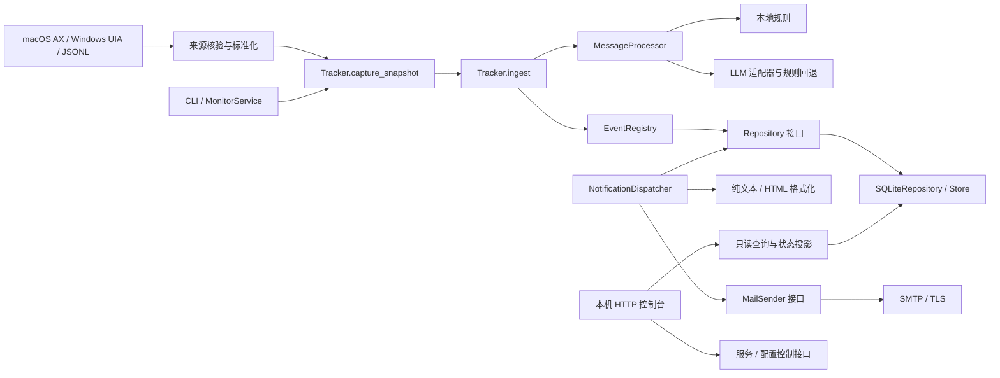

# 架构与扩展契约（1.0.0）

本项目围绕“指定群的捕获证据 → 通知记录 → 可审计投递”组织代码。部署入口负责选择平台，业务用例通过接口调用存储、处理器和发信器。模块划分见根目录 README。

## 依赖方向

- `domain` 只使用标准库计算身份、校验结构和时间，不做 I/O。`domain.policy` 定义落盘的分析策略版本。
- `application` 只导入领域逻辑、纯展示函数和 `ports`。`Tracker` 接收仓储、分析处理器、重算规则分析器、发送器和可替换时钟；不直接读配置或访问 SQL。
- `persistence.SQLiteRepository` 实现仓储契约。`Store` 管连接、建表、完整性检查及备份；仓储管查询、消息去重插入和队列原子领取。
- `extraction.settings` 管校验、热加载、可选共享设置引用与密钥写入；`llm` 管受限 HTTP 和证据核对；`pipeline` 管模式选择与失败回退。`processing.py` 保留旧导入入口。
- `presentation.notifications` 同时用于队列发送和网页预览。SMTP、TLS、邮箱配置校验位于 `notify.py`，业务层不直接导入传输实现。
- `console.handler` 管请求校验、路由和控制操作；`queries` 管只读 SQL；`discovery` 发现受管理实例；`presentation` 白名单投影状态；`server` 管 HTTP 生命周期。`web.py` 保留公共入口。
- `engine.Engine` 是组合根，装配默认适配器，保留 `Engine(store, config)` 调用形式。平台采集、常驻服务和命令行仍使用这一入口。

依赖边界通过 `tests/test_application_boundaries.py` 检查，并用独立内存仓储执行入库及事务回滚，防止“只换目录、仍依赖 SQLite 全局对象”的回退。

## 消息与事务

标准输入为 JSON 对象：`group`、`id`、`kind`、`text`、可选 `sender`/`sent_at`、`children` 和 `attachments`。时间必须带时区；缺失时间保持未知。群名只能等于配置中的精确白名单。校验限制嵌套深度、节点数与文本长度。

`observed_at` 和 `source_meta` 是传输证据，不参与稳定内容指纹；子消息递归遵守同一规则。采集器另保存 `capture_seen` 和 `capture_state`，用于首轮基线与重复采样控制。

`ingest` 先检查消息指纹，调用处理器，再在同一仓储事务中插入原文、写通知及创建队列。二次检查通过 `INSERT OR IGNORE` 解决并发重复插入。分析/入队失败会回滚本轮写入，不吞掉原始输入后伪报成功。外部模型调用发生在写事务之外，避免等待网络时持有数据库写锁。

当前 `lecture-notice-v1` 以来源群、来源消息 ID 和实际来源文本生成通知 ID；同主题的新消息独立通知。旧活动记录的版本、取消与提醒兼容逻辑保留在 `EventRegistry`，不用于对当前讲座通知施加入选或完整度门槛。

## 投递与数据所有权

SQLite 表结构沿用旧版，无本次强制迁移：

| 表 | 职责 |
| --- | --- |
| `messages` | 原始标准化输入和接收时间 |
| `events` | 通知/旧活动记录 |
| `outbox` | 格式快照、版本、原因、计划时间、领取状态、失败计数 |
| `capture_seen` / `capture_state` | 采集指纹和最后成功采样 |
| `forward_reads` | 转发展开结果、尝试次数与退避缓存 |
| `capture_gaps` | 采集缺口起止与原因 |

发信前用条件更新原子领取队列，并验证事件版本；不同连接不能领取同一待发任务。SMTP 在领取事务提交后调用，结果另开事务记账。失败只记录错误类型，避免记录 SMTP 返回的敏感文本；退避从 60 秒指数增长，上限 1 小时，超过 `max_attempts` 标记 `dead`。超过 10 分钟的中断领取可恢复，因而投递语义为至少一次。

`dispatch(send=False)` 不连接 SMTP、不领取或标记为已发送；仍会维护旧版本、关闭的定时提醒和中断任务状态，所以它不是“数据库完全不写入”的查询接口。历史浏览使用 `mode=ro` SQLite 连接，严格不建库或重算。

一个群的数据目录属于一个监控实例，由服务锁和控制通道管理。切群时先探测、暂停旧启动项、停止旧实例、原子保存配置，再使用独立目录；失败尝试恢复原配置和原模式。不要直接改启动项群名后让旧进程继续运行。

## 扩展方法

新增提取器：实现 `MessageProcessor(message, config, *, report) -> list[dict]`，返回保留来源证据的候选通知。通过 `Engine(..., processor=...)` 或 `Tracker(...)` 注入；无需改存储/HTTP。默认管线负责共享场地策略、LLM 响应约束和回退，替换自定义处理器时需自行保持这些契约。

新增存储：实现 `application.ports.Repository`，保证原文/通知/队列同事务和任务原子领取。通过 `Tracker(repository, ...)` 使用，不必创建 `Store`；直接使用 Tracker 时显式传入分析器和发送器。

新增发信渠道：实现 `MailSender` 调用协议，通过 `Engine(..., sender=...)` 注入。预览和失败重试仍由调度器控制，渠道适配器只负责单次提交。

新增平台：在采集适配器实现精确来源核验与标准消息输出，再接入 `capture`/`stream`；不能把桌面控件对象传进业务层。不要用主窗口里任意同名文字证明当前群。
