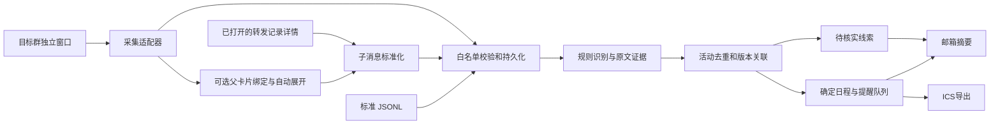

# 方案与框架

## 目标和选型

先以本地 Windows 微信为消息入口，分析目标群中的讲座预告、报名/签到要求、改期取消与相关材料，通过邮箱提醒。当前已确认微信为 4.1.15.13；选择薄 UIA 适配器与可替换输入接口，业务逻辑不依赖客户端版本。

GitHub 核查见 [复用报告](github-reuse.md)。`pywechat` 的 `pyweixin` 是后续扩展导航与普通历史采集的候选；旧 `wxauto` 合并解析的窗口类不能直接用于本机 4.1。当前实现没有复制或安装这些项目代码。



## 采集层

只允许配置中的精确群名。独立群窗口标题、内部群名标签、消息页、消息列表和行类型都匹配才接收。选择器变化时返回明确失败，不回退到其他聊天。

普通消息缺少可靠发送时间、发送者时存 `null`，另记 `observed_at`。观测时间不是发送时间，也不作为相对日期解释的依据。UIA 指纹不是微信真实消息 ID：同内容重发、虚拟列表回收、视口变化存在去重与漏收边界。首次基线防止启动时将可见历史全部当新消息。

合并转发按父卡片和原始子消息存储。详情窗口通常只有通用标题，来源群不能靠此标题证明；显式绑定父消息 ID，并记录绑定来源。父转发时间和转发者不能继承为原始子消息信息。读取到完整原始日期/时刻时才能填子消息 `sent_at`。

当前已打开详情读取不会自动点击链接、下载文件、识别图片或展开下一层卡片。每个无法读取的分支保留 `pending_expansion`，不会把卡片摘要伪装成完整正文。解析上限为4层/100节点；输入校验另设6层/200节点上限，超限会提示人工分批。

新增 `watcher.enrich_forwards` 在分析前按开关补全转发。原生驱动以群窗口句柄、PID、父行runtime id和正文SHA-256重新绑定，要求前台、空闲、无遮挡且没有预先打开的详情；仅接收新出现的唯一同进程详情。操作中检测输入与群名变化，结束验证关闭详情并返回原群。运行句柄只用于当前操作，不充当持久消息ID。

`forward_reads` 按群和父卡片持久化基线、完整/部分读取、失败与下次重试时间。首次基线不会在下一轮被自动展开；`--include-existing`可显式处理基线。完整读取不再打开；部分读取默认10分钟后可补读；失败从30秒退避至15分钟，保留上次可读正文。每轮限制卡片数，遇到一次交互错误停止剩余展开。递归消息身份排除所有层级的观测时间和UI元数据，避免补读产生重复事件或提醒。

## 数据契约

```json
{
  "id": "本地来源ID",
  "group": "2026级计算机研究生通知群",
  "sender": null,
  "sent_at": null,
  "observed_at": "2026-10-15T05:00:00+00:00",
  "kind": "forward",
  "text": "卡片摘要",
  "children": [
    {"id": "原始子ID", "sender": null, "sent_at": "2026-10-15T09:34:00+08:00", "kind": "text", "text": "原始通知"}
  ],
  "attachments": []
}
```

事件字段包括主题、开始/结束/到场/截止时间、地点、主讲人、参与要求、原文证据、来源、置信分值、待核实原因及版本。`confidence` 是规则完整度分数，不是经统计校准的准确率。

`needs_review` 表示有信息需要人工核对；`schedule_ready` 表示足以建立日程。报名资格、文件内容未知可以不影响明确日程；活动日期/时刻冲突、主题/地点缺失、转发原文缺失会阻止自动调度。完整绝对年月日可以独立解析，月日/“明天”必须有可靠原始发送时间。

优先解析明确的“讲座时间”等字段，避免把通知落款日期当活动日期。支持全角冒号和常见时间连接符。报名条款“不能取消报名”不会当作整场讲座取消。

## 持久化、版本和投递

- `messages` 保存标准化原文与稳定内容摘要；`events` 保存活动最新版。
- 相同群、规范化主题、开始时间用于重复公告关联。同主题不同场次保留不同事件；明确改期/取消必须能关联唯一原活动，否则待核实。
- 更新产生新版本，旧版本待发任务和中断恢复任务失效；有原始发送时间时，不让迟到的旧通知回滚新版。
- 取消后收到普通旧公告不自动恢复举办，需要人工核实。改期时旧结束时间不沿用到新日期；提前到场的时差可按原要求平移。
- `outbox` 保存通知快照、到期时间、重试次数及状态；新发现、变更、取消、待核实和临近提醒分别记录。
- 邮件预览不消费队列。真实发送使用带证书验证的 SSL/STARTTLS，凭据从环境变量读取。失败重试间隔为60秒起指数退避，最长1小时，默认5次后进入死信。
- 进程中断可恢复，但无法与外部 SMTP 做跨系统原子事务；极少数情况下可能重复投递。单进程运行最易审计。

## 后续扩展顺序

1. 已实现“定位父卡片→展开→读取→回到父窗口”的实验驱动和协议测试；下一步完成本机原生驱动端到端验收，再处理嵌套详情及主群历史导航。
2. 下载到指定本地目录后，加入 PDF/XLSX 只读文本提取和图片 OCR；保留原文件引用、页码/单元格证据。不要靠文件名判断名单资格。
3. 需要处理自由表达时增加可选模型分析：只发送候选讲座片段，要求结构化 JSON 和逐字段证据，校验通过再入队。模型输出不得执行群消息中的操作指令。
4. 若需要全天候接收，使用专用在线 Windows 会话并记录心跳/断线，测量漏收率和版本变化；单次捕获成功不代表24小时可靠。
