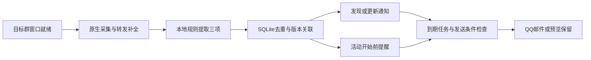

# 微信群讲座监控、识别与提醒机制说明

版本：0.4.0　｜　更新日期：2026-10-15　｜　上线核验：2026-10-15 16:31（北京时间）

## 1. 当前方案与通知内容

目标群为“2026级计算机研究生通知群”。群内讲座由用户手动报名，系统负责发现通知、提取信息及提醒。识别和邮件正文统一为以下三项：

| 项目 | 展示内容 |
| --- | --- |
| 讲座摘要 | 讲座主题，加原通知简介/内容中的简短摘录；更新、取消或待核实标记放在摘要内 |
| 报名截止时间 | 可确定的截止日期和时刻；未出现则显示“未注明”；只有部分时间时保留时间片段并标“待核实” |
| 讲座活动时间 | 开始时间及已明确的结束时间；不完整或冲突时显示时间片段并标“待核实” |

系统不操作报名、不判断本人是否报名成功；地点、主讲、到场时间、签到要求和名单资格不再作为识别字段、通知栏目或排程条件。来源、原文证据和版本保留在本地，用于追踪与去重。

合成通知的邮件正文示例：

```text
讲座摘要：讲座《科研方法》：介绍问题发现与研究设计。
报名截止时间：2026-10-16 18:00（北京时间）
讲座活动时间：2026-10-17 14:30（北京时间）
```

## 2. 监控如何工作

Windows 使用常驻 Python 服务和 PowerShell UIA 采集器，UIA 事件唤醒读取，默认每15秒重新核对窗口。发送队列的目标检查间隔为5秒，故障退避、系统调度或交互等待可能增加延迟。

微信登录且目标群独立窗口打开、非最小化时，采集器核对精确群名和消息列表后自动绑定。微信关闭或窗口不满足条件时进入等待，条件恢复后自动接入。Windows 用户登录任务和每分钟检查提供崩溃恢复；服务支持一键启动、停止、重启与状态查看。



采集覆盖目标窗口已加载、可读取的视口。自动展开只处理经父卡片绑定核对的合并转发；子消息不继承转发者或转发时间。未展开的嵌套卡片保留待核实线索。当前不读取未下载附件、图片正文或链接页面，不能保证关机、锁屏、未加载历史或消息高峰中的完整接收。

## 3. 消息识别与时间解析

当前使用本地正则、字段边界与上下文规则，没有调用大语言模型或语义向量服务。它适合结构清楚的通知，不能保证理解所有自由表达。

识别先查找讲座/学术报告及通知结构；普通聊天如“今天去听讲座吗”不建立活动。对可读取的转发子消息逐条分析，内部保留来源和逐字段证据。摘要以主题为基础，从“讲座简介”“摘要”“内容”等段落或明确的讲座内容句中摘取最多两句，正文片段最多220字符；跳过报名名单、签到、到场等条款。有主题但无内容简介时，只呈现已知主题，不编造内容。

时间字段分别解析，报名截止不混入活动时间；签到截止和“不能取消报名”不当作报名截止或整场取消。完整年月日可直接解析；只有月日或“明天”等相对日期时，必须有带时区的原始发送时间，不能用采集时间补算。输出统一使用北京时间。

| 原通知情况 | 处理结果 |
| --- | --- |
| 主题、活动日期和开始时间明确，未写地点或报名截止 | 正常识别并排活动提醒；截止显示未注明 |
| 截止只写“10月16日”，活动时间明确 | 截止保留日期并标待核实；不补00:00或23:59，不阻止活动提醒 |
| 同日报名时间为09:00-18:00 | 在日期可靠且范围有效时，截止取18:00 |
| 多个截止日期/时刻、无可靠基准的相对日期 | 保留时间证据并标待核实，不强行选择 |
| 活动日期/时刻冲突、星期不一致或主题缺失 | 发待核实摘要，不建立临近提醒或日历事件 |
| 通知没有结束时间 | 仅显示开始时间，不假设时长 |

内部的 needs_review 表示存在待核实信息；schedule_ready 表示主题及活动开始时间足够确定，可以排程。两者独立：截止时间不完整可以标待核实，同时继续提醒明确的活动安排。启发式置信分只反映字段完整度，不是准确率，也不是单独的发送阈值。

## 4. 何时提醒、如何处理变更

默认发现讲座后立即生成一条三项通知。活动时间足够确定时，在开始前24小时和1小时建立未来提醒。报名截止时间当前只展示，不另设截止前定时提醒；不会因识别到截止时间就自动报名。

合成场景：2026-10-15 13:00发现通知，讲座2026-10-17 14:30开始，报名截止为2026-10-16 18:00。实际排程为：

| 时间（北京时间） | 触发原因 |
| --- | --- |
| 2026-10-15 13:00 | 发现后的三项通知 |
| 2026-10-16 14:30 | 活动开始前24小时 |
| 2026-10-17 13:30 | 活动开始前1小时 |

同群、规范化主题及开始时间用于关联重复公告；同主题不同场次可以分别保留。摘要、报名截止或活动安排变化会更新版本；地点、主讲、到场或签到条款变化不生成额外更新通知。明确改期/取消必须能关联唯一原活动，成功后旧版本待发任务作废，按新安排重建。对象不唯一或修改本身含糊时保留待核实线索，不覆盖已知日程。

新截止被明确提及但不完整时，会替换旧确定截止，避免显示失效时刻；简短修改未提截止或内容时可保留之前已知信息。改期没有新结束时间时不平移旧结束时间。取消后邮件摘要标“已取消”，活动时间标取消或原定时间，停止临近提醒。

新建任务不补发已经错过的提醒节点；恢复运行时同一版本的多条到期提醒合并为最近一条，活动开始后的临近提醒失效。新发现摘要与临近提醒是不同任务。ICS手动导出只保存可排程活动及取消更新，描述为摘要和截止，不包含地点、签到或到场规则。

## 5. 邮箱、持久队列与本次迁移

QQ SMTP使用证书校验的SSL/STARTTLS。只有发送模式开启且本机邮箱凭据就绪时才外发。授权码在本机配置并加密保存；未配置时服务继续监控、预览及保留队列，不消耗SMTP重试。失败从1分钟起指数退避，最长1小时，默认5次后进入dead。SMTP与本地记账不能组成原子事务，中断恢复存在重复投递边界。

0.4.0上线前已在隔离副本验证重算，再停止服务、建立完整性校验备份，以事务从8条原始消息重建5条活动或线索。9条旧待发任务保留为superseded审计记录，新方案生成9条pending任务；原始消息、采集指纹及转发缓存保留。数据库继续使用DELETE回滚日志和FULL同步，服务每小时校验备份。

旧库升级命令为rebuild-analysis，须停止服务后执行；已有已发送或发送中记录时拒绝自动重放。0.4.0不会发送尚未迁移的旧方案快照。本机已完成迁移，无需再次执行。

## 6. 已验证状态与使用入口

2026-10-15 16:31上线核验：服务恢复monitoring，采集worker在线；QQ未配置，send_ready=false，真实发送0，生产库完整性ok。150项自动测试通过，覆盖三项通知、摘要摘取、时间不确定、活动开始提醒、更新取消、队列迁移回滚与去重。测试采用隔离数据或模拟SMTP，没有外发邮件。

原24小时只读观察从15:43开始并继续运行。本次计划上线更换了服务实例，观察需记录该变化，不能作为新版本连续24小时通过的证据；心跳在线也不能证明零漏收。Mac独立源码包与Windows共享业务规则，Mac原生编译、微信窗口、Keychain及LaunchAgent实机测试按安排后续进行。

```powershell
python -m wechat_tracker --config config.local.toml service status
python -m wechat_tracker --config config.local.toml service restart
python -m wechat_tracker --config config.local.toml tick
```

最后一行仅预览到期通知，不消费队列。详细操作见[Windows服务](service.md)、[邮箱配置](email.md)、[macOS版本](macos.md)与[架构契约](architecture.md)。
