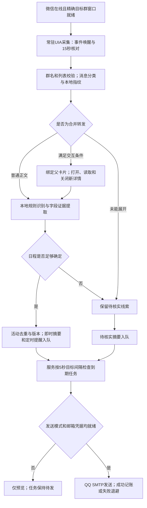

# 微信群讲座监控、语义识别与提醒机制说明

版本：0.3.0　｜　文档日期：2026-10-15　｜　运行状态核验：2026-10-15 16:02:46（北京时间）

本文依据当前实现和本机运行状态编写，说明系统怎样读取目标群、怎样从通知中提取讲座信息，以及何时生成和发送提醒。文中演示通知均为合成样例，已经过当前代码的隔离回放。

## 一、当前方案与运行状态

系统在本机已登录的微信桌面会话中，读取指定群的可访问文字，使用本地规则识别讲座，再将活动、来源和提醒任务保存到SQLite。常驻服务负责持续采集、窗口恢复、队列检查和QQ邮箱发送。当前没有接入大语言模型，也不会把整群原文提交给外部模型。

| 项目 | 核验时的实际情况 |
| --- | --- |
| 目标群 | 2026级计算机研究生通知群 |
| Windows入口 | 微信4.1.15.13；精确群名的独立窗口 |
| 监控服务 | 真实控制连接与进程核验正常，状态为monitoring |
| 常驻采集 | Windows UI Automation（UIA）；事件唤醒，加15秒定期核对 |
| 邮箱 | QQ邮箱，SSL 465；本机凭据按用户安排稍后配置 |
| 实际发送 | 发送模式已启用，但send_ready=false、email_state=not_configured；尚未实际发信 |
| 本地记录 | 8条已处理消息、5条活动或待核实线索、9条pending任务；不等于5场已确认讲座或9封已发送邮件 |
| 数据库 | 当前主库完整性检查为ok；已启用校验备份 |
| 长时观察 | 10月15日15:43开始24小时观察；截至核验时20次采样无异常、无新增断档，尚未完成全天验收 |
| 资源样本 | 上述观察的采样内存峰值约146.5 MiB，平均单核CPU约0.114%；属于短时采样结果 |
| macOS | 独立源码安装包和本地验收命令已交付；原生编译、微信适配和实机行为尚未验证 |

**当前已经在采集和排队，实际邮件提醒需要本机QQ配置完成。** 24小时观察正常或进程在线，都不能证明每条群消息均已完整接收。

## 二、从微信群到提醒的完整链路



15秒和5秒是核对、调度的目标间隔，实际延迟还受微信控件响应、转发展开、故障退避、SMTP响应和网络影响，不是固定的端到端送达承诺。

## 三、监控怎样运行

### 3.1 自动接入的条件

电脑保留已登录的Windows用户会话，微信登录在线，并将目标群打开为独立、非最小化窗口。服务会核对窗口标题、内部群名、消息页和唯一消息列表，条件满足后自动绑定；仅打开微信主界面而没有可核对的目标群窗口，不能视为已接入监控。

窗口未就绪时，采集器低频等待；出现后重新绑定。最小化、窗口不可见或控件失配会进入等待状态，并记录已知采集中断。已实测：最小化后约10秒识别为不可见，恢复后约5秒重新采集，服务和采集进程未重启，断档记录正常结束。此次没有退出微信或操作登录认证。

### 3.2 低占用与尾部跟随

Python服务和PowerShell采集器都保持常驻，避免每15秒新启动一个PowerShell。UIA变化事件只唤醒读取，定期核对补充可能缺失的事件。没有模型推理、OCR或全历史扫描；消息持久化后通过指纹和活动关联减少重复分析、重复排队。

本机开启了尾部跟随。用户空闲至少3秒时，采集器可向已核对的目标群渲染控件发送有限滚动，期间暂存、恢复指针；检测到用户接管就停止。它不主动抢焦点，但可能短暂移动鼠标指针。本机列表没有可靠的ScrollPattern，因此不能通过滚动成功证明已经到达全部历史的真正末尾。可将capture.follow_tail=false关闭该行为，并自行保持消息列表在底部。

### 3.3 合并转发的处理

转发卡片的几行摘要只代表一个入口，不作为完整讲座正文建立日程。本机开启自动展开，但必须同时满足：精确群窗口在前台、用户空闲、父卡片完整可见且无遮挡、同进程没有预先打开的转发详情。

驱动重新核对父行身份和正文摘要，仅单击该卡片；接受新出现的唯一同进程详情，读取后关闭自己打开的窗口，并验证返回原群。已有详情或用户操作冲突时停止，保留缓存并退避。每轮最多3张卡片、每张最多5页、单次超时25秒；无法可靠滚动时保存可读部分并标记不完整。部分结果默认10分钟后补读，失败从30秒退避，最长15分钟。

原生驱动与常驻服务已在本机真实卡片上完成打开、读取、关闭、返回；该次各取得1条可访问正文，历史完整性仍为false。不能由此推断所有卡片、所有历史或嵌套详情都已读全。

### 3.4 覆盖范围

采集覆盖目标窗口中已加载、与消息列表视口相交的行。原始发送者、发送日期没有可靠证据时保留未知，另记采集时刻observed_at。首次运行当前配置include_existing=true，会分析首批可见内容；“新发现”指本工具首次处理，不一定是微信群刚刚发出的消息。

断线期间的未加载历史、瞬间大量消息、锁屏、手动休眠、注销和关机都不能保证补齐。默认防止系统空闲休眠，不阻止手动休眠。服务不会自动完成微信登录认证。

## 四、消息语义识别机制

### 4.1 当前采用本地规则解析

识别器通过正则表达式、字段标签、日期时间解析和少量上下文规则判断候选、提取字段。它没有使用LLM、向量检索、语义嵌入或训练出来的文本分类模型。主要优势是低占用、可追溯；对规则之外的自由表达仍可能漏识别。

处理顺序如下：

1. 恢复字段边界。微信把换行压平时，识别“讲座主题、报告人、活动时间、地点”等标签，尽量恢复独立字段。
2. 判断是否为候选。结合“讲座、学术报告、学术沙龙”等词以及主讲、报告时间、地点等结构；普通聊天“今天去听讲座吗？”不会直接建立活动。没有讲座线索或结构化字段的泛活动通知可能漏识别。
3. 提取主题、开始/结束、到场时间、地点、主讲人、报名截止、参与要求和变更/取消状态。
4. 保留字段来源片段，记录缺失、冲突和附件待核对原因。
5. 分别计算needs_review和schedule_ready，再交给去重与提醒模块。

### 4.2 识别哪些信息

| 字段 | 主要依据及处理方式 |
| --- | --- |
| 主题 | 优先“讲座主题/报告题目/主题”等标签，其次书名号或明确讲座标题 |
| 日期与时刻 | 支持明确年月日、带冒号时刻和常见范围连接符；优先使用“讲座时间/活动时间”等字段 |
| 结束时间 | 解析14:30–16:30等范围；结束不晚于开始时标记歧义，不擅自推断跨夜 |
| 到场时间 | 根据“提前15分钟”等要求，从开始时间向前计算 |
| 地点与主讲人 | 根据地点/会场、主讲/报告人等标签提取 |
| 报名截止 | 与活动时间分开解析；缺少明确时刻时不擅自补成午夜 |
| 参与要求 | 保留签到、签退、不得代签、院章、学分、报名和名额等相关原文行 |
| 字段证据 | 保存对应原文片段，便于回群核对 |

“14:30”“下午2:30”等格式属于当前主要支持范围。“周六两点半”等更自由的表达不属于通用自然语言理解能力范围，可能需要人工核对。多场讲座混在同一正文里，也可能被判为多个日期/时刻冲突；当前没有通用的单消息多事件拆分器。

### 4.3 日期、转发和取消的保守规则

- 有完整绝对日期时可以独立解析；只有“10月17日”时需要可靠的原始发送时间提供年份。
- “今天、明天、后天”必须根据带时区的原始发送时间换算。机器当前日期、采集时刻和转发父消息时间都不能替代原始发送时间。
- 转发子消息独立分析；不把转发人、转发时间继承成原发送者、原发送时间。提供可靠原始时间时才保留它。
- 报名截止与通知落款日期不应混成活动日期。多个活动日期、多个互不相容的时刻或日期与星期冲突时标记待核实。
- “取消报名”“不能取消报名”“不取消讲座”等表达会经过排除规则，避免简单看到“取消”就撤销讲座。

这些是已实现的规则，不代表对所有否定句、口语或复杂通知都有完整理解。

### 4.4 待核实与可排日程是两件事

| 情况 | needs_review | schedule_ready | 提醒行为 |
| --- | --- | --- | --- |
| 主题、明确日期时刻和地点齐全，未发现问题 | false | true | 新发现摘要；未来节点的定时提醒 |
| 日程明确，但报名名单或原发送时间仍需核对 | true | true | 待核实摘要；日程仍可生成定时提醒 |
| 日期/时刻有歧义、地点缺失或未读到转发正文 | true | false | 待核实摘要；不建立该线索的定时提醒 |
| 普通聊天、未进入讲座候选 | 不适用 | 不适用 | 不生成活动或讲座提醒 |

结束时间、主讲人和报名截止并非所有日程的必备字段。取消通知还必须由事件模块找到唯一原活动，才能安全更新。系统不能仅凭“报名成功名单.pdf”文件名或名单附件存在，就确认本人报名成功。

confidence是字段完整度与问题扣分形成的规则分数，最高0.95；未展开转发线索通常为0.15。它不是统计校准的“识别正确概率”，也不是单独控制发送的阈值；日程是否可排主要由字段与歧义条件决定。

## 五、去重、改期与取消

系统有两层去重：消息层排除重复采集，活动层合并同一通知的重复公告。

消息层依据稳定内容摘要和本地消息身份处理；观测时间和UI元数据不参与稳定内容比较。微信没有提供可靠的官方消息ID时，本地指纹依赖群、类型、正文和同文出现次序，仍存在同文重发、虚拟列表回收等边界。

活动层比较同群、规范化主题和开始时间；主题规范化主要去除标点与大小写差异，没有使用语义相似度模型。不同措辞的同一主题不一定自动合并。同主题不同场次应保留不同活动。

明确改期/取消时，优先匹配准确时间或同日活动；必要时关联同主题的唯一原活动。存在多个可能对象时创建待核实线索，不覆盖已知日程。成功变更后版本加一，旧版本待发任务作废，并按新安排重建提醒。缺少新的结束时间时不沿用旧日期的结束时间；到场提前量可按原要求平移。

有可靠原始发送时间时，迟到的旧公告不能回滚更新版本。已经取消的活动收到普通旧公告，也不会直接恢复举办。

## 六、提醒机制

### 6.1 何时建立任务

| 通知类型 | 触发条件 |
| --- | --- |
| 新增 | 首次识别出无待核实问题的活动，立即入队摘要 |
| 待核实 | 发现讲座线索但存在待核实信息，立即入队摘要；日程明确时仍可另外排定时提醒 |
| 变更 | 唯一关联到原活动且内容发生有效变化，立即入队新版本摘要 |
| 取消 | 成功关联并取消原活动，立即入队取消通知，撤销旧待发提醒 |
| 到时提醒 | 日程可排且未取消，根据到场或开始时间建立未来提醒 |

当前提醒节点为1440分钟和60分钟，即提前24小时、1小时。锚点优先使用要求到场时间；没有到场要求时才使用开始时间。每个事件版本与提醒节点有独立去重键。

报名截止会显示在摘要中，**当前没有单独的“报名截止前提醒”任务**。新发现摘要入队不等于邮件立即送达；当前缺邮箱配置时所有任务保持待发。

### 6.2 一个完整计算样例

以下为合成通知，原始发送时间设为2026-10-15 13:00，用于隔离回放：

> 讲座主题：《分布式系统入门》
> 讲座时间：2026年10月17日14:30–16:30
> 地点：计算机学院101报告厅
> 主讲人：张老师
> 请提前15分钟到场，不可代签到。

实际解析得到开始14:30、结束16:30、要求到场14:15，needs_review=false、schedule_ready=true。提醒表如下，均为北京时间：

| 时刻 | 任务 |
| --- | --- |
| 2026-10-15 13:00 | 新发现摘要入队 |
| 2026-10-16 14:15 | 到场时间前24小时提醒 |
| 2026-10-17 13:15 | 到场时间前1小时提醒 |

同一通知增加“报名名单.pdf”附件后，实际回放结果为needs_review=true、schedule_ready=true：提醒日程保留，摘要要求核对名单。把日期改成“明天”且不提供原始发送时间时，开始时间为未知、schedule_ready=false，只保留待核实线索。

### 6.3 队列、预览、发送与失败

提醒任务先写入本地outbox。服务按5秒目标间隔检查到期任务；同时满足发送模式开启和本机凭据可加载，才连接QQ SMTP。缺少凭据时只预览，不把任务记为已发，也不消耗SMTP失败次数。未来到期的任务也会显示为pending，因此pending总数不等于当前立即应发送的邮件数。

发送使用校验证书的TLS。成功后任务标记sent；累计失败达到默认5次进入dead，失败等待从1分钟开始指数增加，最长1小时，错误记录不包含密码或服务器原文响应。dead任务需要后续人工处理，当前没有完整的失败任务管理界面。

重启后消息、事件版本和队列继续保留。中断时处于sending且超过10分钟的任务可恢复待发。SMTP接受邮件与本地“已发”记账无法组成同一事务，因此存在少量重复投递可能；不能承诺严格只发一次。

创建任务时已经错过的提前提醒节点不补建；恢复发送时，同一活动版本的多条积压临近提醒会合并，超过到场/开始时间的临近提醒会失效。这些规则针对reminder任务，不等同于自动清除全部历史新增/待核实摘要。

### 6.4 邮件里包含什么

邮件包含通知类型、主题、开始/结束/到场/截止、地点、主讲人、参与要求、待核实原因、来源群、可知的发送者和记录版本；附带最多1000字符的来源摘录。未知字段明确提示回群核对，不生成个人报名成功结论，不附带群文件。

## 七、运行保障与日常操作

用户登录任务负责启动服务，并通过每分钟触发检查恢复异常退出；IgnoreNew和OS单实例锁防止同一目录重复运行。Windows Job约束采集子进程随父进程退出，worker心跳超时后退避重建。已实测服务异常结束后自动恢复；修复后的实际恢复样本为19.11秒，不是所有机器上的保证时限。

SQLite使用DELETE回滚日志与FULL同步，启动检查完整性；服务每小时生成经校验的快照并保留前一份。日志最多约1 MiB×4，健康与普通日志不写群正文或授权码；数据库保存本地已采集内容。故障库损坏时停止并保留证据，不静默清库。

Windows QQ凭据使用当前账户DPAPI加密，Mac实现为Keychain接口；Mac接口尚待原生验证。授权码只在本机输入，发送测试邮件成功后才保存；本机服务随后自动加载。SMTP会发送上节列出的讲座摘要和摘录，当前不向模型服务发送消息。

在项目根目录执行：

```powershell
# 查看服务与发送就绪状态
python -m wechat_tracker --config config.local.toml service status

# 重启、停止或重新启动
python -m wechat_tracker --config config.local.toml service restart
python -m wechat_tracker --config config.local.toml service stop
python -m wechat_tracker --config config.local.toml service start

# 查看解析记录、队列，以及单次到期邮件预览
python -m wechat_tracker --config config.local.toml events
python -m wechat_tracker --config config.local.toml outbox
python -m wechat_tracker --config config.local.toml tick

# 准备好后在本机配置QQ邮箱；该命令会发送一封明确的测试邮件
python -m wechat_tracker --config config.local.toml email setup
```

双击scripts/restart-monitor.cmd可重启。已安装任务的发送模式由安装参数决定，普通restart沿用该模式；如需变更，重新service install（仅预览）或service install --send。当前本机已安装发送模式，后续QQ配置成功无需为加载凭据专门重启。

stop会暂停自动启动，start重新启用。ICS日历可以手动导出，但当前不是自动日历同步，也没有自动写入手机日历。

## 八、已经验证与仍需完成的部分

| 已有证据 | 仍不能据此声称 |
| --- | --- |
| Windows普通正文、真实单卡原生展开与常驻服务缓存通过 | 所有微信版本、所有卡片及嵌套记录均完整可读 |
| 真实最小化/恢复、进程崩溃恢复、持久化与备份验证通过 | 微信退出重登、锁屏、断电和未加载历史全部覆盖 |
| 129项代码测试及合成规则回放通过 | 语义识别具有已测量的准确率、召回率或通用语言理解能力 |
| 24小时观察已启动，核验时20次采样正常 | 已经完成全天验收，或证明消息零漏收 |
| QQ发送链路和加密配置已实现 | 真实邮箱投递已通过；当前凭据仍未配置 |
| Mac独立源码包、安装器和本地验证命令已交付 | Mac原生编译、微信AX、Keychain、LaunchAgent已实测通过 |

附件下载、PDF/名单正文提取、图片OCR、通用多事件抽取、语义相似度去重和LLM增强均属于后续扩展。现阶段应将“已识别日程”“需要人工核对的信息”和“尚未读取到的内容”分别看待。

## 附：实现与证据位置

| 机制 | 对应文件 |
| --- | --- |
| 常驻服务、缺口、调度与健康 | wechat_tracker/service.py、stream.py |
| Windows读取与转发展开 | wechat_tracker/resources/下的stream-weixin.ps1、probe-weixin.ps1、expand-weixin-forward.ps1 |
| 候选判断、字段和日期规则 | wechat_tracker/analyzer.py |
| 去重、版本、建队和重试 | wechat_tracker/engine.py、store.py、watcher.py |
| 邮件格式与TLS、本机凭据 | wechat_tracker/notify.py、credentials.py |
| 登录启动与Mac适配 | wechat_tracker/autostart.py、macos.py及wechat_tracker/resources/mac-capture.swift |
| 本文运行快照与样例回放 | state/mechanism-document-snapshot.json、mechanism-document-examples.json（本地保留，不入Git） |
| 窗口/转发/长时证据 | state/window-recovery-verification.json、service-native-forward-e2e.json、soak-24h-20261015/ |

进一步操作说明参见[Windows服务管理](service.md)、[自动转发](automatic-forward.md)、[邮箱配置](email.md)和[Mac安装验收](macos.md)。
